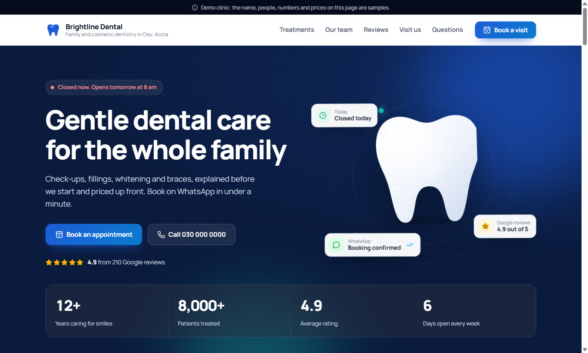
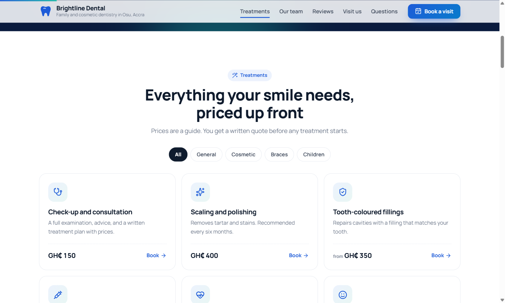
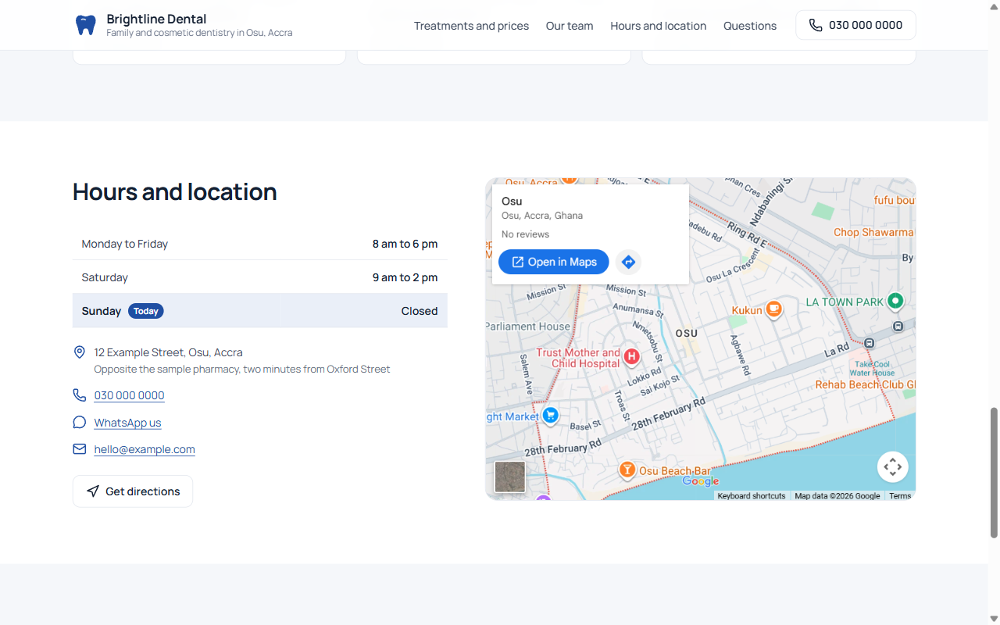
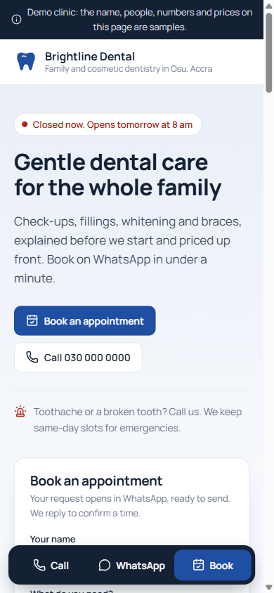
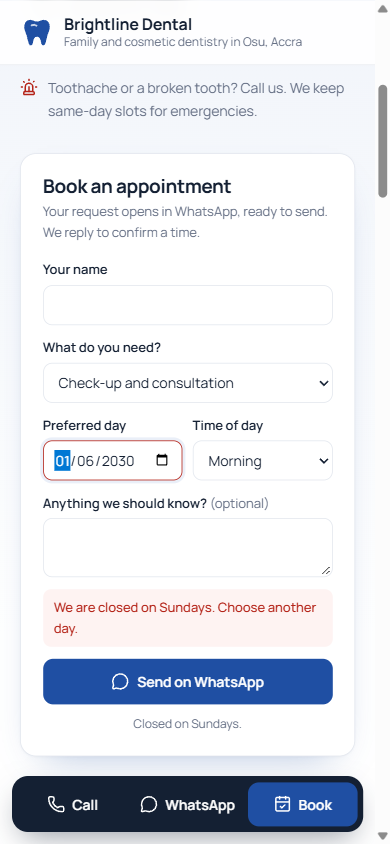

# Dental clinic website template

A fast, one-page website for a dental clinic, set up from **one settings file**. It's built for clinics in Ghana and similar markets:
- patients book on WhatsApp
- the page shows whether the clinic is open right now
- prices are listed up front
- on phones, Call, WhatsApp and Book stay within reach of a thumb

**[See the live demo](https://ohenemanaf.github.io/dentist/)**. It shows a fictional clinic, Brightline Dental, with sample details.



| Treatments and prices | Hours and location |
|---|---|
|  |  |

| Phone | Booking on a closed day |
|---|---|
|  |  |

## What a clinic gets

- **Live opening status.** "Open now until 6 pm", "Closing soon" or "Closed now. Opens Monday at 8 am", worked out in the clinic's time zone, whatever the visitor's own.
- **Booking on WhatsApp.** The visitor fills in their name, treatment, day and time of day, and WhatsApp opens with the message written and addressed to the clinic. Closed days and past dates are refused with a clear message. If the clinic has no WhatsApp, the request opens in the visitor's email app instead.
- **Treatments with prices**, as a clear price list, plus the ways to pay (cash, Mobile Money, cards, insurance).
- **First-visit steps, team, reviews and questions**, so nervous patients know what to expect.
- **Hours table with today highlighted**, the address with a landmark, a map and a "Get directions" button.
- **A phone bar** fixed at the bottom of the screen: Call, WhatsApp, Book.
- **Shows up properly on Google.** The page tells search engines it's a dentist, with the opening hours, phone and address.
- **Light and quick.** There are no frameworks or tracking scripts. The font and icons are served from the site itself, and the whole page is under 100 KB before the map loads.

## Setting it up for a clinic

1. Copy this repository, or click **Use this template** if it's enabled on GitHub.
2. Open `clinic.config.mjs` and fill in the clinic's details. Each setting is explained in the file.

   | Setting | What it changes |
   |---|---|
   | `demo` | Set to `false` to remove the "demo clinic" notice |
   | `name`, `tagline`, `headline`, `intro` | The words on the first screen |
   | `brand` | The clinic's colour. Every other shade is worked out from it. |
   | `logo` | Optional logo image. Without it, a tooth mark in the brand colour is used. |
   | `contact` | Phone, WhatsApp number (digits only, with country code), email, address, landmark, map search |
   | `hours`, `timeZone` | Opening hours per day on a 24-hour clock, `null` for closed days |
   | `services`, `currency`, `priceNote` | Treatments with an icon, a description and a price (`from: true` adds "from") |
   | `team` | Names, roles and a line about each person, with an optional photo |
   | `steps`, `reviews`, `faqs`, `payment`, `social` | The remaining sections. Empty `reviews` hides that section. |

3. Build the page:
   ```
   node tools/build.mjs
   ```
   This writes `index.html`. You need [Node.js](https://nodejs.org) 20 or newer, and nothing else to install. If a setting is wrong, the build stops and says exactly what to fix:
   ```
   Cannot build the site:
     - Service "Teeth whitening" uses icon "toothy", which is not in assets/icons.svg.
     - hours.sat should look like ['08:00', '17:00'].
   ```
4. Publish the folder anywhere that serves static files: GitHub Pages, Netlify, Vercel, or the clinic's own hosting.

### Icons for treatments

The available icons are:

`stethoscope` `sparkles` `shield-check` `shield-plus` `syringe` `heart-pulse` `smile` `crown` `gem` `scan-face` `baby` `toothbrush` `toothbrush-sparkles` `brush` `microscope` `activity` `pill` `droplet` `zap` `siren` `award` `badge-check` `hand-heart` `heart-handshake` `users` `user-round` `hospital` `ambulance` `accessibility`

To add another, copy its SVG from [lucide.dev](https://lucide.dev) into `assets/icons.svg` as a `<symbol>`, following the same pattern as the others.

### Photos

Real photos of the clinic and team help patients trust it. Use square team photos of about 400 × 400 px, under 100 KB each. Put them in `assets/images/` and set `photo: 'assets/images/dr-name.jpg'` on each team member.

## Project layout

```
clinic.config.mjs      all the clinic's details (the only file to edit per clinic)
tools/build.mjs        builds index.html from the settings, and checks them first
assets/js/hours.js     opening-hours logic, used by the page and by the tests
assets/js/site.js      open-now status, today in the hours table, the booking form
assets/css/site.css    styles; all colours come from the one brand colour
assets/icons.svg       icon set (Lucide)
assets/fonts/          Manrope
tests/                 run with: npm test
```
